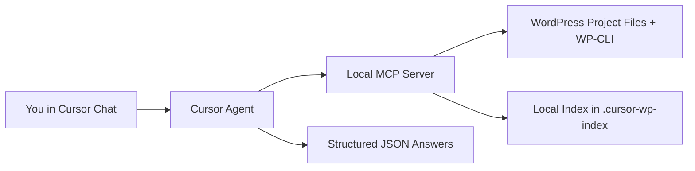
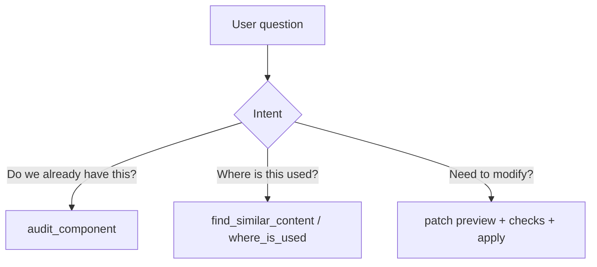

# WP Agent MCP Demo

## What this does

- Lets Cursor answer normal WordPress build questions with MCP tools behind the scenes.
- Checks whether a component already exists, where it is used, and how to make safe updates.
- Prefers reuse over creating new blocks.

## Architecture at a glance

## Why this architecture

- Local-first: no external service required for project scanning.
- Deterministic outputs: JSON contracts for audit/search responses.
- Safe changes: patch-first workflow with validation before apply.
- Lazy indexing: build/refresh only when needed, not every session.

## Demo prompts
1. Ask: `Do we already have a compact testimonial section?`
2. Ask: `Find pages or templates that use a footer disclosure.`
3. Ask: `Summarize the active theme's design system.`
4. Ask: `Apply the prepared patch to add a compact testimonial variant.`
5. Ask: `Implement this hero section in our WordPress theme` and provide a Figma link or screenshot.

## Design bridge expected outcome (prompt 5)

- The assistant checks WordPress readiness and explains if Figma MCP is needed (screenshots work without it).
- The assistant interprets design intent semantically and returns an implementation spec mapped to theme tokens and existing components.
- Implementation uses theme preset CSS variables, not raw Figma literals.

## Expected outcomes

- The assistant confirms WordPress project context and index readiness.
- The component audit returns whether the testimonial section exists, partially exists, or 
is missing, with a reuse/extend/create recommendation.
- Similarity search returns concrete usage locations for the footer disclosure.
- Theme profile summary reflects active design tokens, conventions, and helpers used by the 
project.
- Patch flow previews a minimal diff, runs safety checks, and applies only when requested.

## Close 

"WP Agent helps teams move faster in WordPress by answering build questions from real project context, then guiding safe, minimal changes."
